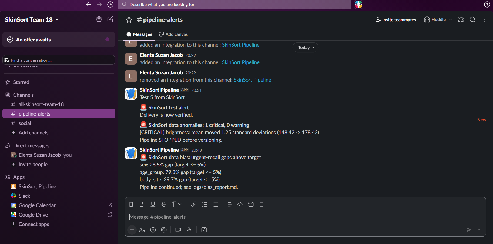
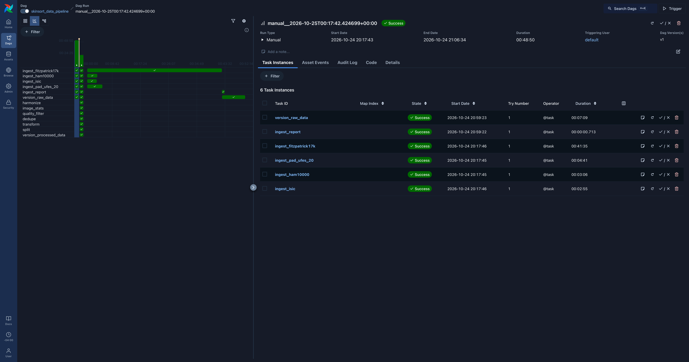
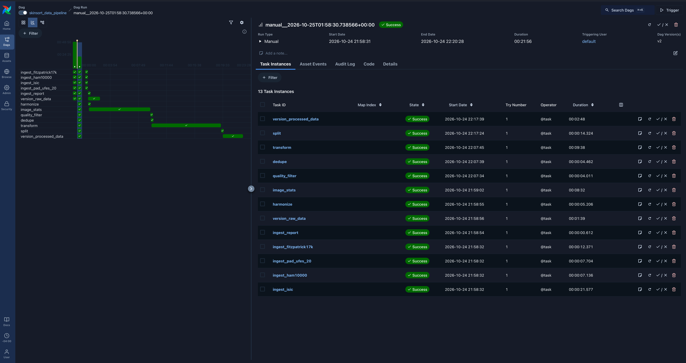

# SkinSort — Data Pipeline

Airflow pipeline that downloads, validates, preprocesses and versions the four
SkinSort datasets (ISIC Archive, HAM10000, PAD-UFES-20, Fitzpatrick17k).

> **Status:** acquisition, preprocessing, schema & statistics (Great Expectations),
> anomaly detection with Slack alerts, bias slicing and mitigation (Fairlearn),
> orchestration, DVC versioning and 100 unit tests are in place.

## Pipeline (current DAG)

```
ingest_isic ─────────────┐
ingest_ham10000 ─────────┤                ┌─ version_raw_data
ingest_pad_ufes_20 ──────┼─ ingest_report ┤
ingest_fitzpatrick17k ───┘                └─ harmonize ─ image_stats ─ quality_filter
                                              ─ dedupe ─ transform ─ split ─ validate_schema
                                              ─ detect_anomalies ─ bias_slicing ─ version_processed_data
```

| Task | What it does | Output |
|---|---|---|
| `ingest_isic` | Pages the ISIC API v2 per diagnosis group (caps in `params.yaml`), downloads images in parallel | `data/raw/isic/` |
| `ingest_ham10000` | Harvard Dataverse API, verifies MD5 of each zip, extracts images | `data/raw/ham10000/` |
| `ingest_pad_ufes_20` | Mendeley API, verifies SHA-256 of each zip, extracts images | `data/raw/pad_ufes_20/` |
| `ingest_fitzpatrick17k` | GitHub CSV, then each image from its atlas URL; verifies each image against the MD5 in the CSV; skips links that were 404 last run | `data/raw/fitzpatrick17k/` |
| `ingest_report` | Counts per dataset | `logs/ingest_report.json` |
| `version_raw_data` | `dvc add data/raw` + `dvc push` | `data/raw.dvc` |
| `harmonize` | One common schema for all datasets; diagnosis → canonical label → urgency tier | `data/interim/harmonized.csv` |
| `image_stats` | Opens every image once: size, brightness, contrast, sharpness, perceptual hash (process pool) | `data/interim/image_stats.csv` |
| `quality_filter` | Drops unreadable, too small, too dark/bright, flat or blurry photos | `quality_passed.csv`, `logs/quality_report.json` |
| `dedupe` | Removes ISIC↔HAM copies and cross-pool near-copies; merges near-copies into one split group | `deduped.csv`, `duplicates_dropped.csv` |
| `transform` | Centre-crop + resize, Shades-of-Gray colour constancy; encodes age/sex/site/answers with missing flags | `data/processed/images/`, `features.csv` |
| `split` | 70/15/15 by patient/lesion group, stratified by urgency; PAD has its own split; Fitzpatrick17k = fairness test only; fails on any leakage | `data/processed/dataset.csv`, `logs/split_report.json` |
| `validate_schema` | 30 Great Expectations rules on `dataset.csv`; statistics snapshot; **stops the run** if any rule fails | `logs/schema_report.json`, `logs/data_statistics.json` |
| `detect_anomalies` | Compares the run with a reviewed baseline (missing values, outliers, drift, label mix, row count); Slack alert on any finding, **stops the run** on critical ones | `logs/anomaly_report.json` |
| `bias_slicing` | Fairlearn slices by sex, age, body site, skin tone, source; reweighing + ThresholdOptimizer; Slack warning on large gaps (never stops) | `logs/bias_report.md/.json`, `data/processed/sample_weights.csv` |
| `version_processed_data` | `dvc commit` + `dvc push` of all stage outputs | `dvc.lock` |

Downloads run in parallel. Every task retries twice with exponential back-off
and sends an alert when it finally fails. The same steps are declared in
`dvc.yaml`, so `dvc repro` rebuilds the processed data without Airflow.

## Preprocessing decisions

* **Labels.** `configs/harmonization.yaml` maps each dataset's labels to one
  canonical diagnosis; `configs/urgency_mapping.yaml` maps diagnoses to
  routine / priority / urgent (draft, to be checked against a clinical source).
  The step fails if any diagnosis has no tier, so nothing is silently unlabelled.
* **HAM10000 `akiec`** mixes actinic keratosis with Bowen's disease (SCC in situ)
  and cannot be separated; it is mapped to *priority* and flagged for review.
* **Missing patient answers.** Only PAD-UFES-20 has answers (itch, grew, hurt,
  changed, bleed, elevation). Everyone else gets `q_*_missing = 1` instead of a
  made-up value. Duration and "other similar spots" (from the scoping doc's four
  questions) exist in no public dataset.
* **Leakage.** Splits are by patient, else lesion, else image. Near-duplicate
  photos (pHash ≤ 4 bits apart) are merged into one group; copies across the
  dermoscopic / PAD / Fitzpatrick pools are removed. `split` re-checks that no
  group or hash appears in two splits and fails otherwise.
* **Augmentation** (blur, crop, brightness to mimic phone photos) happens at
  training time, not here, so each epoch sees new variants.

## Data validation: schema and statistics

`scripts/validation/schema.py` runs right after `split`. Rules are Great
Expectations expectations built from `params.yaml` and `configs/`, so changing a
threshold never means editing code. If any rule fails, the reports are still
written, the task fails, and the Airflow failure alert fires, so invalid data is
never versioned.

| Area | Rules |
|---|---|
| Table | all required columns present (taken from the pipeline's own column lists); 20,000-30,000 rows |
| Identifiers | `image_id` never empty and unique; `group_id` never empty |
| Labels | `source`, `split`, `urgency` only known values; every `diagnosis` exists in `urgency_mapping.yaml` |
| Demographics | `sex`, `body_site` known categories; `age` 0-120 with at most 25 % missing (today 17.1 %); `fitzpatrick` 1-6 when present |
| Patient answers | `q_*` only 0 or 1 when present |
| Image quality | every image readable, no errors; width/height, brightness, contrast, sharpness within the quality filter's limits; `phash` 16 hex characters |

`logs/data_statistics.json` records row and column counts, missing rates,
numeric ranges and the urgency mix per split for every run.

**Data card (processed `dataset.csv`, 25,300 rows x 61 columns)**

| Column group | Columns | Notes |
|---|---|---|
| IDs | `image_id`, `source`, `source_image_id`, `patient_id`, `lesion_id`, `group_id`, `image_path`, `processed_image` | `patient_id` missing for 81.6 % (HAM10000, Fitzpatrick17k have none) |
| Labels | `diagnosis_raw`, `diagnosis`, `urgency`, `split` | urgency: urgent / priority / routine |
| Demographics | `age`, `sex`, `body_site`, `fitzpatrick` | `fitzpatrick` missing for 78.9 % |
| Patient answers | `q_itch`, `q_grew`, `q_hurt`, `q_changed`, `q_bleed`, `q_elevation` (+ `_missing` flags) | PAD-UFES-20 only, ~91 % missing |
| Image statistics | `readable`, `error`, `width`, `height`, `brightness`, `contrast`, `sharpness`, `phash` | from `image_stats` |
| Model features | `age_missing`, `age_bin_*`, `sex_*`, `site_*` | from `transform` |

## Anomaly detection and alerts

`scripts/validation/anomalies.py` compares each run with
`reference/baseline_profile.json`, a profile of a reviewed good run kept in Git.
Limits live in `params.yaml` under `anomaly`.

| Check | Warn (alert, continue) | Critical (alert, **stop**) |
|---|---|---|
| Missing values: rise in a column's missing share | +2 points | +10 points |
| Outliers: rise in share outside the baseline's IQR fences (Q1 - 3 IQR, Q3 + 3 IQR) | +2 points | +10 points |
| Drift: mean shift in baseline standard deviations | 0.25 | 1.0 |
| Label mix: urgency-mix total variation distance per split | 3 % | 10 % |
| Row count: relative change | 5 % | 25 % |

Schema violations are caught one step earlier by `validate_schema`. The team
agreed to alert on small issues and stop only on big ones (`stop_on: critical`).
Refresh the baseline only after a person has reviewed a run, then commit it:

```bash
python -m scripts.validation.anomalies --update-baseline
git add Data-Pipeline/reference/baseline_profile.json
```

**Alerts in Slack** (`#pipeline-alerts`): a delivery test, a critical brightness
drift that stopped the run before versioning, and a bias warning that let the
run continue.



While connecting Slack we found that `send_alert` reported success for any HTTP
200 reply, including Slack's docs page returned for a malformed webhook. It now
counts an alert as delivered only when Slack answers `ok`, and `tests/test_alerts.py`
covers delivered, malformed, redirected and revoked webhooks.

## Bias detection and mitigation

`scripts/validation/bias.py` uses data slicing in two ways:

* **Representation:** images and urgent rate per slice (sex, age group, body
  site, skin tone, source) in each split.
* **Performance:** no image model exists yet, so a proxy model (logistic
  regression on age, sex, body site and image statistics) is trained on `train`
  and scored on `test` + `pad_test`. Fairlearn's `MetricFrame` reports **urgent
  recall** per group. A gap is only judged for groups with at least 20 urgent cases.

**Findings (proxy model, current data)**

| Slice | Urgent-recall gap | Lowest group | Highest group |
|---|---|---|---|
| Age group | **79.8 %** | 30-44 | 75-119 |
| Source | 40.3 % | ham10000 | isic |
| Body site | 29.7 % | unknown | upper_extremity |
| Sex | 26.5 % | female | unknown |
| Skin tone | 4.4 % (light vs unknown only) | unknown | light (I-III) |

Overall urgent recall is 77.1 %; the project target is a gap of at most 5 points.

| Skin tone images | light (I-III) | dark (IV-VI) | unknown |
|---|---|---|---|
| train | 93 | **0** | 13,314 |
| test | 13 | **0** | 2,855 |
| pad_train | 991 | 51 | 559 |
| pad_test | 204 | 14 | 121 |
| fairness_test | 1,813 | 1,919 | 153 |

* **Age:** skin cancer is more common with age, so the model leans on age and
  misses urgent cases in younger patients (unequal base rates).
* **Source:** ISIC was sampled with urgent groups over-sampled, so "looks like
  an ISIC image" correlates with urgency. This is sampling bias from a pipeline
  decision and is flagged to the team rather than mitigated here.
* **Skin tone:** the training data has no type IV-VI images and `pad_test` has
  only 14, too few to judge. The small measured gap compares light with unknown
  only; it is missing evidence, not evidence of fairness. Darker skin must be
  evaluated on the held-out Fitzpatrick17k fairness set.
* **Image type vs skin tone** (scoping feedback). The measured 4.4-point skin-tone
  gap compares "light" images, almost all smartphone photos from PAD-UFES-20,
  with "unknown" images, almost all dermoscopic ISIC/HAM10000 photos, so it
  partly measures image type. The 40-point source gap shows how strongly image
  origin alone moves results. Fitzpatrick17k is clinical photography of 114
  conditions, so comparing `test` with `fairness_test` would mix skin tone with
  image type too. Skin-tone gaps must therefore be compared within one image
  type: across Fitzpatrick types inside `fairness_test` (all clinical) and inside
  PAD-UFES-20 (all smartphone). Fitzpatrick17k's conditions are mapped to
  urgency in `configs/harmonization.yaml`: named cancers first, then its own
  malignant / benign / non-neoplastic grouping.

**Mitigation on the worst slice (age group)**

| Method | Recall gap | Overall urgent recall | Balanced accuracy |
|---|---|---|---|
| Baseline | 79.8 % | 77.1 % | 74.4 % |
| Reweighing (Kamiran & Calders) | 16.4 % | 62.3 % | 68.6 % |
| ThresholdOptimizer (equal true-positive rate) | 42.9 % | 75.6 % | 71.3 % |

**Trade-offs.** Reweighing closed most of the gap but lowered overall urgent
recall from 77.1 % to 62.3 %, so more urgent cases would reach the routine
queue. ThresholdOptimizer roughly halved the gap with almost no loss of recall.
Because a missed urgent case is the costliest error in triage, we prefer
group-aware thresholds, which fit SkinSort's existing safety threshold. Neither
method fixes the root cause: more data for younger patients and darker skin
types. Reweighing weights are exported to `data/processed/sample_weights.csv`
(never changing `dataset.csv`) so the modelling stage can re-test both methods
on the image model. All numbers come from a proxy model and are recomputed for
the final model; the full report is regenerated each run in `logs/bias_report.md`.

## Pipeline flow optimisation (Airflow Gantt)

**Run 1 — downloads only, 48 min 50 s** ([full screenshot](docs/gantt_run1_before.png))



`ingest_fitzpatrick17k` took **41 min 35 s** while the other three downloads
finished in 3–5 min, and `ingest_report` / `version_raw_data` had to wait for it.
Its log showed why: ~12,600 of its 16,536 image links (all on dermaamin.com)
return HTTP 404, and each dead link takes ~8 s to answer.

**Fixes**

| Bottleneck | Fix | Effect |
|---|---|---|
| Dead Fitzpatrick17k links re-tried every run | Links that returned 404 are remembered in `failures.csv` and skipped (`skip_known_404`); timeouts and 5xx are still retried | 41.6 min → **0.2 min** |
| Every download re-fetched | Per-dataset `manifest.csv` with checksums; files already present are skipped | ISIC 2.9 → 0.4 min, HAM 3.1 → 0.1, PAD 4.7 → 0.1 |
| Four independent downloads | Run as parallel Airflow tasks; images within a dataset use a 16-thread pool | wall time = slowest download, not the sum |
| `version_raw_data` blocking preprocessing | Runs in parallel with `harmonize` instead of before it | ~1.7 min off the critical path |
| Full-resolution decode of 4,900 px ISIC JPEGs | JPEG draft-mode decode at reduced scale in `image_stats` / `transform`; both use a process pool over all cores | ~1.6× faster per image in a local benchmark |

**Run 2 — downloads + full preprocessing, 21 min 56 s** ([full screenshot](docs/gantt_run2_after.png))



Run 2 does far more work (7 extra preprocessing tasks) in under half the time.
The remaining long bars are `image_stats` (8.5 min) and `transform` (9.6 min):
CPU-bound image work on the VM's 4 cores. Next options: a larger VM for
preprocessing runs, or merging both passes so each image is decoded once.

## Folder structure

```
configs/                             # (repo root) harmonization + urgency mapping
Data-Pipeline/
├── dags/skinsort_data_pipeline.py   # Airflow DAG
├── scripts/
│   ├── common/                      # config, logging, HTTP, files, alerts
│   ├── ingest/                      # one module per dataset
│   ├── preprocess/                  # harmonize, image_stats, quality, dedupe, transform, split
│   ├── validation/                  # schema (Great Expectations), anomalies, bias (Fairlearn)
│   └── versioning.py                # DVC add / commit / push
├── reference/baseline_profile.json  # reviewed baseline for anomaly checks (in Git)
├── tests/                           # pytest unit tests (network fully faked)
├── data/                            # raw/, interim/, processed/ (DVC-tracked, not in Git)
├── logs/                            # pipeline.log, *_report.json, Airflow logs
├── params.yaml                      # every tunable value
├── dvc.yaml                         # same steps as the DAG, for `dvc repro`
├── Dockerfile, docker-compose.yaml  # Airflow 3.3.2 with LocalExecutor
└── requirements.txt, requirements-dev.txt
```

## Setup

### Option A — run on the team GCP VM (recommended)

The VM `skinsort-airflow` (us-east1-b) already has Docker and this repo.
It uses the `skinsort-pipeline` service account, so no key file is needed.

```bash
gcloud compute instances start skinsort-airflow --zone=us-east1-b
# open the Airflow UI through an SSH tunnel (port 8080 is not public)
gcloud compute ssh skinsort-airflow --zone=us-east1-b -- -L 8080:localhost:8080
# then browse to http://localhost:8080   (login: see Data-Pipeline/.env on the VM)

# when finished — the VM costs ~$0.13/hour while running
gcloud compute instances stop skinsort-airflow --zone=us-east1-b
```

### Option B — run locally with Docker

```bash
gcloud auth application-default login          # lets DVC/GCS use your account
cd Data-Pipeline
cp .env.example .env                           # set AIRFLOW_UID=$(id -u) on Linux
docker compose up -d --build
# http://localhost:8080
```

### Development environment (tests, lint, running one step)

```bash
python3.11 -m venv .venv && source .venv/bin/activate
pip install -r Data-Pipeline/requirements-dev.txt
cd Data-Pipeline
pytest                    # unit tests, no network needed
flake8 .                  # PEP 8
python -m scripts.ingest.isic --limit 5              # quick real download test
python -m scripts.ingest.fitzpatrick17k --limit 50
dvc pull dvc.yaml                                     # processed data only (~0.9 GB, not the 10 GB raw)
python -m scripts.validation.schema                   # run one validation step on its own
python -m scripts.validation.anomalies
python -m scripts.validation.bias
```

On Windows, use WSL 2 (Ubuntu): Windows 11 Smart App Control blocks pandas'
unsigned compiled files, and the paths and shell commands above are for Linux.
Install Python 3.11 with `uv python install 3.11` if Ubuntu ships a newer one.

## Running the pipeline

In the Airflow UI, un-pause **skinsort_data_pipeline** and press *Trigger*, or:

```bash
docker compose exec airflow-scheduler airflow dags trigger skinsort_data_pipeline
```

Downloads are idempotent: files already recorded in a dataset's
`manifest.csv` are skipped, so a failed run can simply be re-triggered.

## Data versioning (DVC)

* Remote: `gs://skinsort-data-asdr/dvc-store` (default remote `gcs`, see `.dvc/config`).
* `version_raw_data` updates `Data-Pipeline/data/raw.dvc`. Commit that pointer file
  so the data version is recorded in Git history:
  `git add Data-Pipeline/data/raw.dvc && git commit -m "data: <what changed>"`.
* Teammates get exactly the same data with `dvc pull`.
* Going back to an older data version: `git checkout <commit> -- Data-Pipeline/data/raw.dvc && dvc checkout`.

## Logging and alerts

* Every step logs to the Airflow task log **and** `logs/pipeline.log` (rotating).
* `logs/ingest_report.json` summarises each run (images listed, downloaded, failed).
* Failed downloads are listed in `data/raw/<dataset>/failures.csv`.
* Alerts: set `SLACK_WEBHOOK_URL` and/or `ALERT_EMAIL_TO` + `SMTP_*` in `.env`.
  Without them, alerts are still written to the log.
* Slack: workspace *SkinSort Team 18*, channel `#pipeline-alerts`, app
  *SkinSort Pipeline* (incoming-webhook scope only). The webhook URL is a secret:
  it lives only in `.env` (git-ignored) or a shell variable, never in Git.
* Alerts come from task failures (all tasks), schema violations, anomalies
  (warn or critical) and bias gaps above target.

## Datasets and known issues

| Dataset | Source | Notes |
|---|---|---|
| ISIC Archive | `api.isic-archive.com/api/v2` | Capped subset per diagnosis group; IDs frozen in `metadata.csv`. The API's reported file size is ~3 KB smaller than the served JPEG, so size is not checked. |
| HAM10000 | Harvard Dataverse `doi:10.7910/DVN/DBW86T` | `image_id` values are ISIC IDs, which makes ISIC/HAM de-duplication exact. |
| PAD-UFES-20 | Mendeley `zr7vgbcyr2` v1 | Only dataset with patient answers (itch, grew, hurt, changed, bleed). |
| Fitzpatrick17k | `github.com/mattgroh/fitzpatrick17k` | **Fairness evaluation only, never redistributed.** As of Oct 2026 all `dermaamin.com` links (~76% of rows) return 404; only `atlasdermatologico.com.br` images (~3.9k) download. `min_success_rate` is set to 0.2 accordingly. |

Licences: HAM10000 and parts of ISIC are CC BY-NC — SkinSort is an academic,
non-commercial project. Each ISIC image's licence is kept in `metadata.csv`.
